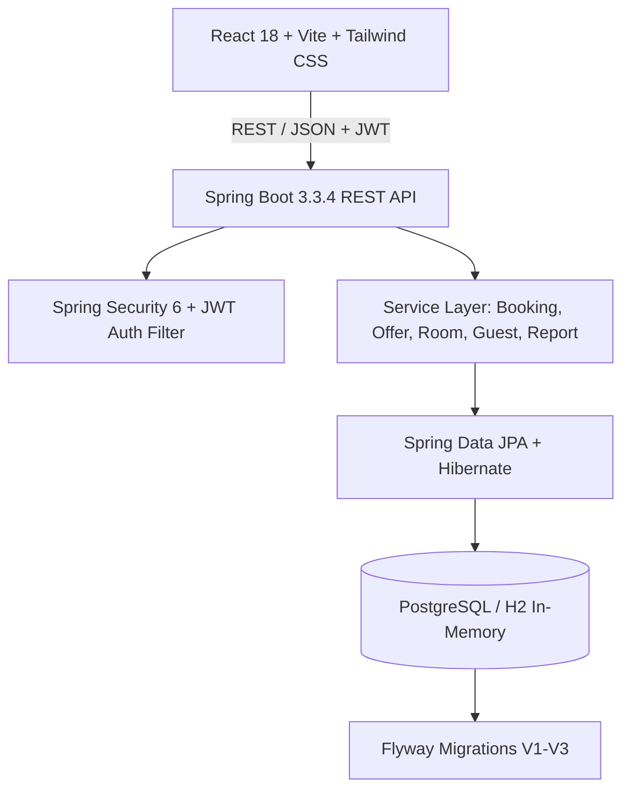

# Roomly — Luxury Hotel Reservation & Property Management System

**Roomly** is an end-to-end hotel reservation and property management enterprise platform. It features an architecture combining a **Java 21/Spring Boot 3** REST backend with a **React 18 / Vite / TypeScript / Tailwind CSS** frontend.

---

## 🌟 Major Highlights & New Features

### 💳 Admin-Controlled Limited-Time Credit Card Offers
- **Customer Checkout Integration**: Customers see eligible credit card promotions (e.g., HDFC Bank 10% off, SBI Credit Card 15% off, ICICI Bank flat $50 off) directly on the `/checkout` page with banking badges, card network categories, minimum spend rules, expiry countdowns, and terms & conditions.
- **Backend Discount Engine**: Server-side discount calculation (`min(amount * rate / 100, cap)` for percentage discounts, or fixed value). Frontend discounts are never trusted blindly; the server enforces eligibility rules, minimum booking amounts, validity windows, and limits.
- **Transaction-Safe Redemptions**: Concurrency-safe counter updates and persistent `offer_redemptions` tracking prevents over-redemption and respects per-customer limits.
- **Admin Console CRUD (`/admin/offers`)**: Dedicated sidebar entry allowing hotel administrators to launch new bank offers, toggle instant active status, edit parameters, and safely archive used campaigns without violating referential integrity.
- **Sandbox Disclaimers**: All demonstration banking offers are labeled with sandbox notices ensuring compliance.

---

## 🏗️ Architecture & Technology Stack



### Backend:
- **Framework**: Spring Boot 3.3.4 (Java 21 / 25 compatible)
- **Security**: Stateless JWT Bearer Authentication, BCrypt password hashing, method-level `@PreAuthorize("hasRole('ADMIN')")`
- **Data & ORM**: Spring Data JPA, Hibernate ORM, Flyway database migrations
- **Databases**:
  - `local` profile: Embedded H2 database with automatic schema generation and seed provisioning
  - `prod` profile: PostgreSQL with Flyway migration scripts (`V1__init_schema.sql`, `V2__seed_initial_data.sql`, `V3__create_offers_table.sql`)
- **Documentation**: OpenAPI 3.0 & Swagger UI at `/swagger-ui.html`

### Frontend:
- **Core**: React 18, TypeScript, Vite 5
- **Routing**: React Router v6 with `ProtectedRoute` guards for Customer and Admin portals
- **State & Data Fetching**: TanStack React Query v5 with optimistic cache invalidation
- **Forms & Validation**: React Hook Form + Zod schema validation
- **Styling**: Tailwind CSS with custom Roomly luxury design tokens
- **Icons & Charts**: Lucide React, Recharts

---

## 🚀 Running the Project Locally

### 1. Backend (Spring Boot)
```bash
cd backend

# Option A: Run directly with Maven Wrapper using local H2 profile
./mvnw.cmd spring-boot:run -Dspring-boot.run.profiles=local

# Option B: Run pre-built executable JAR
java -jar target/roomly-backend-1.0.0.jar --spring.profiles.active=local
```
- **REST API**: `http://localhost:8080/api/v1`
- **Swagger UI**: `http://localhost:8080/swagger-ui.html`
- **H2 Web Console**: `http://localhost:8080/h2-console` (JDBC URL: `jdbc:h2:mem:roomly_db`, User: `sa`, Password: `password`)

### 2. Frontend (React + Vite)
```bash
cd frontend

# Install dependencies (first time only)
npm install

# Start development server on port 3000
npm run dev
```
Open **[http://localhost:3000](http://localhost:3000)** in your browser.

---

## 🔑 Default Credentials

| Persona | Email | Password | Role & Permissions |
|---|---|---|---|
| **Hotel Administrator** | `admin@roomly.com` | `admin123` | Full access to Admin Console, Suite Inventory, Guest CRM, Offers CRUD, Analytics |
| **Loyalty Customer** | `customer@roomly.com` | `customer123` | Browsing, Suite Reservation, Card Offers Application, Personal Stay History |

---

## 📡 Credit Card Offers API Specification

### Customer-Facing Endpoints
| Method | Endpoint | Access | Description |
|---|---|---|---|
| `GET` | `/api/v1/offers` | Public | List active, non-expired offers. Optional query param `bookingAmount` filters by minimum spend. |
| `GET` | `/api/v1/offers/{id}` | Public | Retrieve full details of a specific offer. |
| `POST` | `/api/v1/offers/validate` | Public | Validate eligibility and calculate exact discount amount for a booking amount, customer email, and card. |

#### Sample Validate Request (`POST /api/v1/offers/validate`):
```json
{
  "offerCode": "HDFC10",
  "bookingAmount": 500.00,
  "customerEmail": "customer@roomly.com",
  "cardNetwork": "Visa"
}
```
#### Sample Validate Response:
```json
{
  "isValid": true,
  "message": "Success! $50.00 discount applied with HDFC Bank Credit Card — 10% Instant Savings.",
  "offerId": "84aaaa5c-53ed-482a-9c50-0bf7c2cd7828",
  "offerCode": "HDFC10",
  "offerTitle": "HDFC Bank Credit Card — 10% Instant Savings",
  "bankName": "HDFC Bank",
  "originalAmount": 500.00,
  "discountAmount": 50.00,
  "finalAmount": 450.00
}
```

---

### Admin Offer Management Endpoints
| Method | Endpoint | Access | Description |
|---|---|---|---|
| `GET` | `/api/v1/admin/offers` | Admin Only | List all campaigns with search (`search`), bank filter (`bank`), status (`isActive`), and pagination. |
| `GET` | `/api/v1/admin/offers/stats` | Admin Only | High-level metrics: Active Offers, Total Redemptions, Total Discount Granted. |
| `POST` | `/api/v1/admin/offers` | Admin Only | Create a new banking offer with strict validation. |
| `PUT` | `/api/v1/admin/offers/{id}` | Admin Only | Update existing offer rules, caps, dates, or terms. |
| `PATCH` | `/api/v1/admin/offers/{id}/status` | Admin Only | Immediately activate or deactivate an offer (`{ "isActive": true/false }`). |
| `DELETE` | `/api/v1/admin/offers/{id}` | Admin Only | Delete unused offer, or safely archive it if redemptions exist to preserve history. |

---

## 🧪 Automated Verification Suite

Run the end-to-end integration and security test suite:
```bash
cd backend
node scratch/test_credit_card_offers.js
```
The test suite validates:
1. Authentication of Admin and Customer personas.
2. Server-side role authorization (`403 Forbidden` on non-admin access to `/admin/offers`).
3. Admin retrieval of offers and stats.
4. Admin creation of custom campaign (`AMEX20`).
5. Customer discovery of active campaigns.
6. Discount rules enforcement (minimum spend rejection, percentage capping, fixed amount).
7. End-to-end booking creation with offer redemption.
8. Per-customer redemption limit enforcement.
9. Campaign total redemption ceiling enforcement under concurrency.
10. Admin instant status toggle, safe archiving, and data persistence.

---

## 🌐 Cloud Deployment Guide (Render)

Roomly is pre-configured for automated 1-click deployment on **Render** using `render.yaml`.

### Architecture on Render:
1. **PostgreSQL Database (`roomly-db`)**: Managed PostgreSQL 16 with automated Flyway migrations.
2. **Backend Web Service (`roomly-backend`)**: Docker container running Spring Boot 3.3.4 (Java 21).
3. **Frontend Static Site (`roomly-frontend`)**: Vite React Static Site with SPA client-side routing fallback.

### Deployment Steps:
1. Fork or push this repository to GitHub.
2. In the [Render Dashboard](https://dashboard.render.com/), click **New +** -> **Blueprint**.
3. Connect your GitHub repository. Render reads `render.yaml` and provisions all 3 services automatically.
4. Once `roomly-backend` deploys, verify its health probe at:
   ```
   https://<your-backend>.onrender.com/api/v1/health
   ```
5. Open your `roomly-frontend` static site URL in your browser and explore the full platform.
